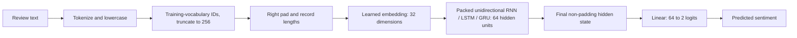
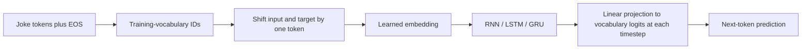

# Stage 4 model architectures

Classification (RNN, LSTM, and GRU share the pipeline):

The LSTM's final hidden state, not its cell state, feeds the classifier. Training uses cross-entropy and Adam. The dimensions shown describe the comparable classification pilots, not the default settings for every experiment. Lengths include at least one token; padding is excluded by packing.

Generation architecture:

Generation uses teacher forcing during training; padding targets are excluded from the loss. See `Method_RNN_Generation.py` and `Generate_Text.py` for sampling details.
